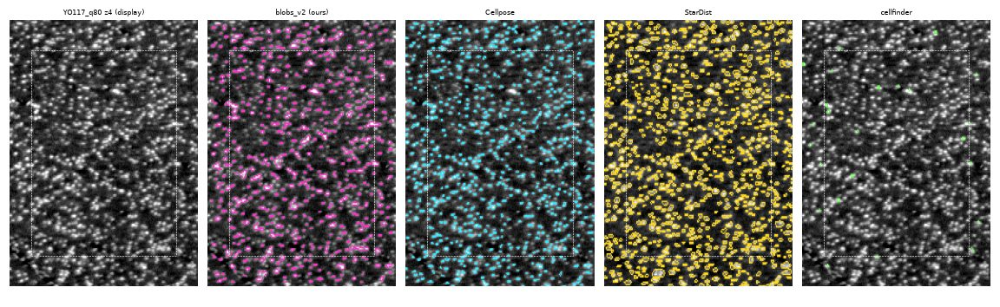
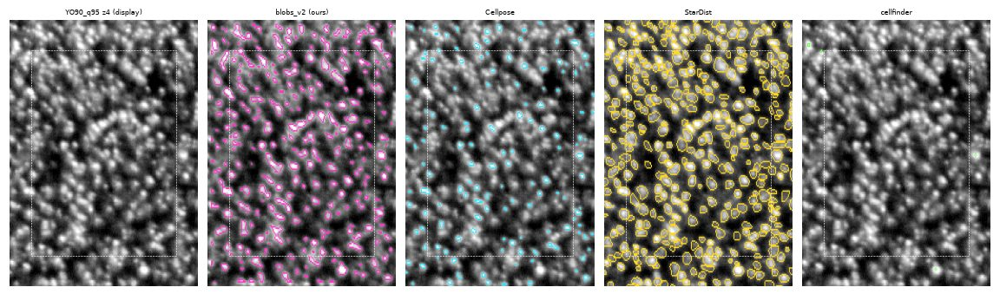
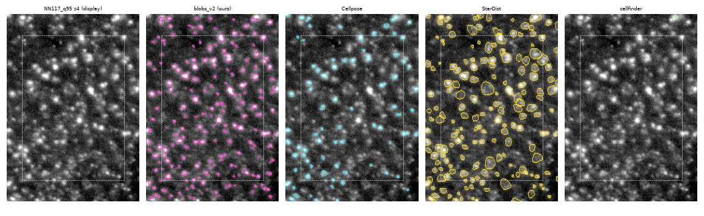
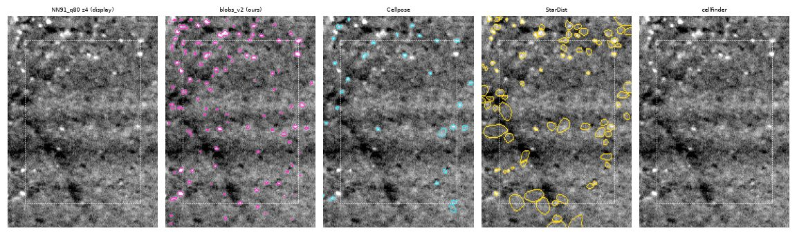
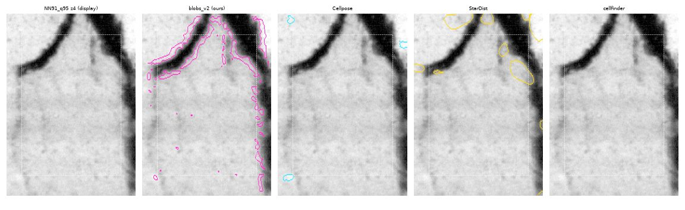
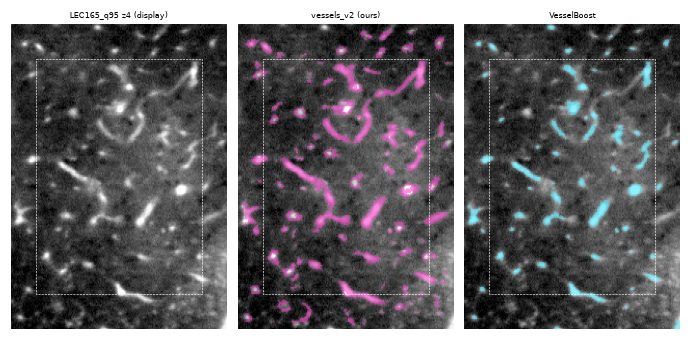
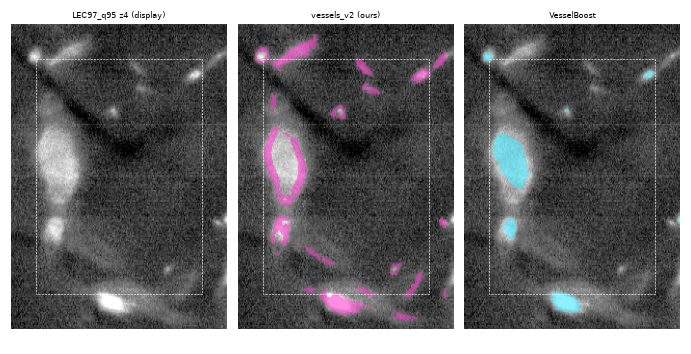

# Hand-written programs vs Neurodesk reference models (label-free)

DANDI 000108 ships no labels, so **nothing here is accuracy**. The reference models (Cellpose 3 `nuclei`, StarDist
`2D_versatile_fluo`, cellfinder candidate detection, VesselBoost) are established tools trained or tuned on *other* data
(cultured cells and DSB nuclei, mouse whole-brain light-sheet, human MR angiography); they are a second opinion, not ground
truth. The numbers measure how much the methods agree with each other on the same real windows, next to how much the
references agree among themselves and how much agreement chance alone gives.

## Investigation: what the Neurodesk apps provide

| candidate | Neurodesk app | weights host (browser-fetchable?) | size | licence | input spec | post-processing | 2-D / 3-D | used? |
|---|---|---|---|---|---|---|---|---|
| Cellpose 3 `nuclei` | `apps/cellpose` | HF dataset `neurodeskorg/webapps`, revision-pinned; CORS `*` (checked with an `Origin` header) | 26.5 MB | BSD-3 code and weights (HHMI); training data include CC-BY-NC sets | 2 channels (nuclear + zeros), `normalize99` 1-99th pct, rescale to diam_mean 17 px, 224-px tiles, 10% overlap, pad to /16 | flow dynamics 200 steps, mask clustering, flow-error QC 0.4, fill holes, min 15 px | 2-D (3-D = ortho-plane averaging, not used) | yes |
| Cellpose 3 `cyto3` | same | same | 26.5 MB | same | cytoplasm (+ nuclear) channel | same | 2-D | no (we have a nuclear stain) |
| StarDist `2D_versatile_fluo` | `apps/stardist` | HF `neurodeskorg/webapps`; CORS `*` | 5.7 MB | BSD-3 | 1 channel NHWC, 1-99.8th pct, /16, grid 2 | prob 0.479, polygon NMS 0.3 (clipper-lib, Boost) | 2-D | yes |
| StarDist `3D_demo` | same | same | - | BSD-3 | anisotropy 2:1:1, 96 rays | polyhedron NMS | 3-D | no (demo model) |
| cellfinder detection | `apps/lightsheet-atlas` (JS port of cellfinder 1.10.1) | none (classical) | - | BSD-3 | uint16 raw, voxel sizes in um, soma 16 um default | LoG + mean+10 SD threshold, 3-D ball filter, splitting -> points | 3-D | yes (points drawn as spheres) |
| micro-SAM `vit_t_lm` / MobileSAM | `apps/microsam` | HF `neurodeskorg/webapps` | 28 + 16.5 MB | CC BY 4.0 (micro-sam), Apache-2.0 (MobileSAM) | 1024 x 1024 encoder | prompt decoder only; AMG / AIS automatic segmentation not in the port | 2-D (+ z propagation) | no: needs prompts |
| VesselBoost | `apps/vesselboost`, `packages/vesselboost` | HF `sbollmann/neurodesk-webapps-assets`; CORS `*` | 26.3 MB | code MIT; weights NOASSERTION | 64^3 patches, z-score | sigmoid, threshold 0.1, components >= 10 voxels | 3-D | yes, experimental (MRA-trained) |
| Big-FISH spots | `apps/spot-detection` | none | - | BSD-3 | LoG at spot radius | local maxima, elbow threshold | 2-D/3-D | no: diffraction-limited spots |
| `gpu-unet` kernels | `packages/runtime-support/src/gpu-unet` | - | - | - | WebGPU FP32 3-D U-Net kernels used by MRI apps | - | 3-D | no: onnxruntime-web covers our models |
| SynthSeg, MindGrab, Brainchop | MRI apps | - | - | - | MRI contrasts | - | 3-D | no: MRI-specific |

## How the comparison was run

`demo/test/nd_compare.mjs` (headless Chromium on a Slurm node: our programs on the WebGPU engine via SwiftShader, the
references with onnxruntime-web 1.29.0 on 4 WebAssembly threads) streams real level-0 windows from DANDI 000108 (MITU01;
the middle strip of each slab; per strip the 80th and 95th percentile blocks of a level-4 intensity ranking, i.e. tissue-rich
spots), runs every model on the same 208 x 208 x 9 voxel window (160 x 160 scored core + 24 px context margin; the central 5
planes are scored, the outer 2 on each side are context), exactly as the hook does, and dumps the label volumes;
`scripts/nd_compare.py` computes the numbers and the overlays. Objects are scored when their 3-D centroid lies in the core.
Matching: Hungarian assignment of centroids, tolerance half the declared diameter (YO 10 um -> 5 um; NN 16 um -> 8 um).
Chance: the same counts placed uniformly at random in the scored volume (20 draws). Our programs get the exposure window
from our `exposure` program (as in the viewer); the references get their own percentile normalization over the window's
central plane.

## Results (14 windows, 2026-11-24)

Run: `demo/test/nd_compare.mjs` on a Slurm CPU node, onnxruntime-web 1.29.0 on WebAssembly (4 threads, cross-origin
isolated test server), our programs on SwiftShader WebGPU; then `python scripts/nd_compare.py OUT FIGDIR --md tables.md`.
Windows: YO slabs 90 and 117, NN slabs 40, 91 and 117, LEC slabs 165 and 97 (MITU01), two windows each.

### Cells: counts per window (objects with centroid in the scored core) and run time

| window | tol (um) | blobs_v2 (ours) | Cellpose | StarDist | cellfinder |
|---|---|---|---|---|---|
| YO90_q80 | 5 | 130 (15 s) | 95 (177 s) | 198 (23 s) | 54 (0 s) |
| YO90_q95 | 5 | 168 (15 s) | 120 (144 s) | 258 (25 s) | 4 (0 s) |
| YO117_q80 | 5 | 423 (17 s) | 831 (110 s) | 704 (17 s) | 13 (0 s) |
| YO117_q95 | 5 | 385 (15 s) | 761 (119 s) | 753 (25 s) | 7 (0 s) |
| NN40_q80 | 8 | 0 (16 s) | 0 (86 s) | 0 (6 s) | 0 (0 s) |
| NN40_q95 | 8 | 0 (15 s) | 1 (49 s) | 0 (3 s) | 0 (0 s) |
| NN91_q80 | 8 | 87 (19 s) | 33 (50 s) | 143 (5 s) | 0 (0 s) |
| NN91_q95 | 8 | 28 (15 s) | 4 (64 s) | 7 (5 s) | 0 (0 s) |
| NN117_q80 | 8 | 37 (15 s) | 15 (54 s) | 18 (4 s) | 11 (0 s) |
| NN117_q95 | 8 | 142 (14 s) | 62 (52 s) | 141 (7 s) | 0 (0 s) |

### Cells: centroid-matching F1 (chance F1 for the same counts) and mean IoU of matched objects

| window | blobs_v2 (ours) vs Cellpose | blobs_v2 (ours) vs StarDist | blobs_v2 (ours) vs cellfinder | Cellpose vs StarDist | Cellpose vs cellfinder | StarDist vs cellfinder |
|---|---|---|---|---|---|---|
| YO90_q80 | 0.36 (0.02) / 0.25 | 0.40 (0.02) / 0.40 | 0.07 (0.02) / 0.08 | 0.39 (0.02) / 0.15 | 0.34 (0.01) / 0.27 | 0.09 (0.01) / 0.06 |
| YO90_q95 | 0.42 (0.02) / 0.29 | 0.40 (0.03) / 0.34 | 0.01 (0.00) / 0.05 | 0.31 (0.02) / 0.15 | 0.02 (0.00) / 0.30 | 0.00 (0.00) / nan |
| YO117_q80 | 0.48 (0.07) / 0.45 | 0.43 (0.07) / 0.25 | 0.03 (0.00) / 0.09 | 0.58 (0.10) / 0.26 | 0.02 (0.00) / 0.18 | 0.02 (0.00) / 0.11 |
| YO117_q95 | 0.48 (0.07) / 0.46 | 0.41 (0.07) / 0.28 | 0.01 (0.00) / 0.13 | 0.57 (0.10) / 0.29 | 0.01 (0.00) / 0.20 | 0.01 (0.00) / 0.14 |
| NN40_q80 | empty | empty | empty | empty | empty | empty |
| NN40_q95 | 0.00 (0.00) / nan | empty | empty | 0.00 (0.00) / nan | 0.00 (0.00) / nan | empty |
| NN91_q80 | 0.35 (0.02) / 0.29 | 0.37 (0.06) / 0.25 | 0.00 (0.00) / nan | 0.23 (0.03) / 0.31 | 0.00 (0.00) / nan | 0.00 (0.00) / nan |
| NN91_q95 | 0.00 (0.00) / nan | 0.06 (0.00) / 0.06 | 0.00 (0.00) / nan | 0.00 (0.00) / nan | 0.00 (0.00) / nan | 0.00 (0.00) / nan |
| NN117_q80 | 0.42 (0.01) / 0.28 | 0.29 (0.02) / 0.13 | 0.42 (0.01) / 0.33 | 0.42 (0.02) / 0.16 | 0.46 (0.01) / 0.17 | 0.41 (0.00) / 0.27 |
| NN117_q95 | 0.44 (0.04) / 0.30 | 0.61 (0.07) / 0.33 | 0.00 (0.00) / nan | 0.49 (0.04) / 0.21 | 0.00 (0.00) / nan | 0.00 (0.00) / nan |
| **pooled** (all matches / all objects) | **0.46** (0.03) / 0.33 | **0.42** (0.03) / 0.25 | **0.03** (0.00) / 0.13 | **0.51** (0.03) / 0.22 | **0.05** (0.00) / 0.22 | **0.02** (0.00) / 0.14 |

### Cells: equivalent diameter of 3-D objects (um), median [IQR], pooled per stain

| stain | blobs_v2 (ours) | Cellpose | StarDist | cellfinder |
|---|---|---|---|---|
| NN | 13.0 [7.7-18.9] n=294 | 12.6 [10.1-16.9] n=115 | 16.6 [12.9-23.7] n=309 | 15.4 [15.4-15.4] n=11 |
| YO | 11.6 [7.1-17.5] n=1106 | 8.2 [6.1-11.7] n=1807 | 15.3 [10.8-18.8] n=1913 | 9.5 [9.5-9.5] n=78 |

### Vessels (LEC): mask agreement in the scored core

| window | area ours | area VesselBoost | Dice | IoU | ours inside VB | VB inside ours | time ours / VB |
|---|---|---|---|---|---|---|---|
| LEC165_q80 | 9.4% | 2.0% | 0.29 | 0.17 | 18% | 85% | 33 / 9 s |
| LEC165_q95 | 12.6% | 5.4% | 0.51 | 0.34 | 36% | 84% | 33 / 8 s |
| LEC97_q80 | 0.0% | 0.0% | 0.00 | 0.00 | 0% | 0% | 34 / 11 s |
| LEC97_q95 | 6.4% | 4.1% | 0.27 | 0.15 | 22% | 34% | 31 / 12 s |

### Sensitivity to the declared diameter (YO 117, both windows)

The 2-D networks see objects at a fixed pixel size, so the declared diameter is a real parameter. Same windows, diameter
7 / 10 / 14 um (the matching tolerance is half the diameter, so F1 values are not comparable across columns; the chance
column shows how much a larger tolerance alone gives):

| diameter | ours (unchanged) | Cellpose count | StarDist count | Cellpose vs StarDist F1 (chance) | ours vs Cellpose F1 (chance) | ours vs StarDist F1 (chance) |
|---|---|---|---|---|---|---|
| 7 um | 808 | 1526 | 1393 | 0.43 (0.04) | 0.39 (0.03) | 0.28 (0.02) |
| 10 um (default) | 808 | 1592 | 1457 | 0.58 (0.10) | 0.48 (0.07) | 0.42 (0.07) |
| 14 um | 808 | 1311 | 2198 | 0.56 (0.23) | 0.61 (0.16) | 0.43 (0.17) |

Cellpose's count moves by about 20% over a 2x range of diameters; StarDist's by 60% (at 14 um it resamples less and
splits more). Cellpose's masks stay smaller than the nuclei at every setting (median equivalent diameter 6.5 um at 7 um, 8.4 um at 14 um;
8.2 um pooled over YO at 10 um).

## What the numbers and overlays say

Looked at: every overlay in `figs/` (central plane of each window, scored core dashed; a subset is committed as JPEG).

* **Agreement between our blobs_v2 and the references is in the same range as the agreement between the two references.**
  Pooled over all windows: ours vs Cellpose F1 0.46, ours vs StarDist 0.42, Cellpose vs StarDist 0.51; chance for the same
  counts 0.03-0.04. On the dense YO 117 windows the three agree on most bright nuclei (F1 0.41-0.58); none of the pairs is
  close to 1, so with no labels we cannot say which is right where they differ.
* **Counts differ systematically.** On dense YO the references find about twice as many objects as ours (YO 117: 830 / 700
  vs 420 per core): blobs_v2 merges touching neighbours into one object (visible in the overlays as elongated outlines over
  two or three nuclei) and its noise-relative threshold drops dim nuclei. On sparser YO 90 ours sits between Cellpose
  (fewer) and StarDist (more).
* **Sizes.** Matched objects overlap little (mean IoU 0.25-0.33): Cellpose outlines sit inside the bright core of each nucleus
  (YO median 8.2 um), StarDist polygons extend beyond it (15.3 um), ours are in between (11.6 um) but include merged pairs
  (wide IQR, 7-18 um). At 2.6 x 3.6 um voxels a 10 um nucleus is 3-4 voxels wide, so a one-voxel boundary difference is
  already an IoU change of about 0.3; low IoU here mostly says the boundary is not resolved, not that the objects differ.
* **Where ours is worse.** NN 91 q95 is a tissue edge with dark cracks: blobs_v2 outlines the crack rims (28 objects, a known
  limitation), Cellpose and StarDist mark 4 and 7 objects (mostly in the context margin). The references reject this
  structure, ours does not.
* **Where the references are worse.** StarDist with the NN default (16 um) draws large polygons over diffuse NeuN-negative
  texture on NN 91 q80 where neither ours nor Cellpose finds anything; the NN slabs' bright objects are smaller than the
  declared soma size there. Both NN 40 windows are dark (intensities near the floor): all models return 0-1 objects, so no
  model hallucinates on empty tissue.
* **cellfinder** (classical, tuned for sparse labels in mouse whole-brain light-sheet) mostly agrees with nothing (pooled F1 0.02-0.05; per window up to
  0.09, except YO 90 q80 vs Cellpose 0.34 and NN 117 q80 0.41-0.46). With its default threshold (mean + 10 SD of the filtered plane) it found no candidates at
  all in dense YO windows; at our setting of 3 SD it finds 4-54 per core. Its ball filter and per-plane statistics assume
  isolated bright cells on a dark background, which a pan-nuclear stain is not; it is kept as a classical reference, not as a
  competitor.
* **Vessels (LEC).** VesselBoost (trained on human MR angiography) marks the brightest, thickest vessel segments only (2-5%
  of the core area vs 6-13% for our vessels_v2); 84-85% of its mask lies inside ours on LEC 165, 34% on LEC 97 (where it
  fills a large bright vessel ours only outlines). Ours additionally marks thin and dim vessels that are visible in the
  image, and some round bright spots VesselBoost also marks. Both are empty on the dark LEC 97 q80 window. Dice 0.27-0.51.
  This says VesselBoost transfers partially and conservatively from MRA to light-sheet; it is not evidence that our extra
  area is correct.

## Caveats

* Not accuracy: no labels; each reference is out of its training domain (Cellpose / StarDist: 2-D cultured / DSB-style nuclei
  at about 17 / 16 px; cellfinder: sparse mouse labels; VesselBoost: MRA). Their disagreement with each other is the scale
  of the uncertainty.
* Scored on the window's central 5 planes and 160 x 160 core with a 24-px context margin; 2-D models are linked across z
  with our own rule, so z splits / merges are shared with our programs and do not count against either.
* 14 windows from 7 slabs of one subject; the window choice (80th / 95th percentile of block brightness at level 4)
  favours tissue-rich spots.
* Only defaults were evaluated (plus the diameter sweep); the references' thresholds were not tuned, ours were tuned earlier
  on other real crops of the same dataset.
* Run time is CPU WebAssembly in a headless browser (per 208 x 208 x 9 window: Cellpose 50-180 s, StarDist 3-25 s,
  cellfinder < 1 s, VesselBoost 8-12 s for 16 patches; our programs 14-34 s on software WebGPU). The WebGPU execution
  provider on SwiftShader was much slower than WASM; real-GPU speed was not measured.

Reproduce:

```bash
# on a Slurm node with Playwright + SwiftShader (see demo/test/nd_compare.mjs header for env)
DEMO_ROOT=demo OUT_DIR=$G/ndcmp_full Z=9 CORE=160 node demo/test/nd_compare.mjs
CELLS=NN:117 VESSELS= ONLY=fable_blobs_v2,nd_cellpose,nd_stardist,nd_cellfinder OUT_DIR=$G/ndcmp_full node demo/test/nd_compare.mjs
python scripts/nd_compare.py $G/ndcmp_full $G/ndcmp_full/figs --md tables.md
```

Overlays (central plane; dashed = scored core):  
  
 
